<p align="center">
  
</p>

<p align="center">
  
  <a href="https://github.com/SovatharaProm?tab=followers">
    
  </a>
</p>


### `> whoami`

```ts
const sovathara = {
  roles:      ["Technical Business Analyst", "Full Stack Developer", "DevOps"],
  superpower: "turning business requirements into shipped software",
  pipeline:   ["requirements", "user stories", "API & data design", "code", "deploy"],
};
```


<p align="center">
  
</p>


### `> git log --stats`

<p align="center">
  
  
</p>

<p align="center">
  
</p>


### `> ./play --contributions`

<p align="center">
  
</p>


